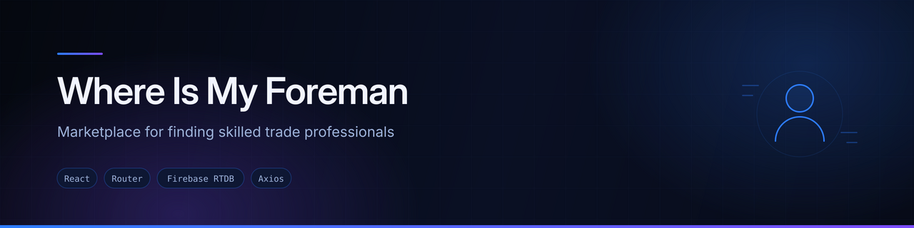
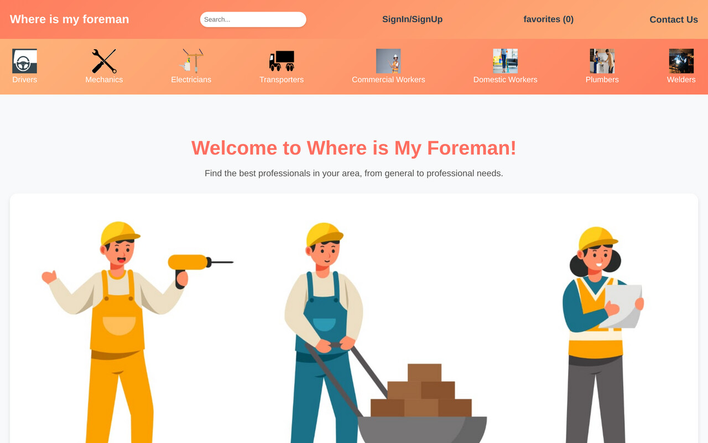

<div align="center">
  
</div>

<div align="center">


</div>

## Overview

**Where Is My Foreman** is a web marketplace for finding skilled trade professionals. A visitor picks a trade, browses available workers, opens a profile to see experience, day rate, languages and contact details, and saves the ones they want to get in touch with.

It covers eight trade categories:

`Drivers` · `Mechanics` · `Electricians` · `Plumbers` · `Welders` · `Transporters` · `Commercial workers` · `Domestic workers`

This is a **working front-end prototype**. Worker profiles come from seeded JSON datasets bundled with the app rather than a live database, so the listings and detail pages are fully functional but the data is sample data.

## Preview



<sub>Screenshot captured from a local production build of this repository.</sub>

## Features

- **Eight trade category pages**, each listing the available workers for that trade
- **Individual worker profiles** on their own route (`/drivers/:name`, `/plumbers/:name`, and so on) showing role, years of experience, day rate, availability, languages, location and contact number
- **Favourites list** — save workers while browsing and review them on a dedicated page, backed by a React Context provider
- **Sign-up and sign-in** — account details are written to and read from a Firebase Realtime Database over its REST endpoint
- **User registration page** for workers wanting to be listed
- **Supporting sections** on the landing page — hero, why choose us, success stories, warranty, FAQ and support, newsletter sign-up, call to action
- **Contact page** for general enquiries
- **Responsive layout** throughout, from hand-written component stylesheets

## Tech stack

| Layer | Technology |
|---|---|
| Framework | React (Create React App) |
| Routing | React Router DOM — 22 routes |
| Styling | Hand-written CSS, one stylesheet per component |
| State | React Context (`CartContext`) for the favourites list |
| Data | Seeded JSON datasets in `src/Components/Data/` |
| Accounts | Firebase Realtime Database via Axios REST calls |

## Project structure

```
src/
├── Components/
│   ├── HomePage/        Landing page composition
│   ├── Hero/            Hero section
│   ├── LoginPage/       Sign-up and sign-in
│   ├── Cart/            Saved-workers page
│   ├── Users/           Worker registration form
│   ├── SuccessStories/  Testimonials section and page
│   ├── Data/            Seeded worker datasets (JSON)
│   └── …                Navbar, Footer, FAQ, Newsletter, Warranty, WhyChooseUs
├── Pages/               One listing page per trade category
├── Singles/             One detail page per trade category
├── Context/
│   └── CartContext.jsx  Favourites provider and useCart hook
└── App.js               Route definitions
```

## Running locally

```bash
git clone https://github.com/AJAY2043/foreman-project.git
cd foreman-project
npm install
npm start
```

The development server runs at `http://localhost:3000`.

```bash
npm run build     # production build into ./build
```

> Because the app uses client-side routing, a production build must be served with a catch-all rewrite to `index.html`, otherwise deep links such as `/plumbers` return a 404 from the host.

## Configuration

Account sign-up and sign-in call a Firebase Realtime Database URL that is currently hard-coded in `src/Components/LoginPage/Login.jsx`. To point the app at your own Firebase project, create a `.env` file at the project root:

```bash
REACT_APP_FIREBASE_DB_URL=https://your-project-default-rtdb.firebaseio.com
```

…and read it via `process.env.REACT_APP_FIREBASE_DB_URL` in place of the hard-coded value.

## Known limitations and next steps

Being honest about where this prototype stands:

- **Authentication is not production-grade.** Sign-up writes credentials directly to the Realtime Database and sign-in compares them client-side. This should move to **Firebase Authentication**, with database rules locking `users` down.
- **Worker data is static.** The eight JSON datasets should become a real collection in Firestore or a backend API, with an admin path for workers to manage their own listings.
- **Unused dependencies.** `express`, `mysql2`, `multer`, `redux`, `react-redux`, `bootstrap` and `react-bootstrap` are declared in `package.json` but are never imported in `src/`. They are left over from an earlier plan for a Node backend and a Bootstrap UI, and should be removed — or those plans finished.
- **No search or filtering yet.** Listing pages would benefit from filtering by location, rate, availability and rating.
- **Favourites do not persist.** The Context state resets on reload; `localStorage` or a per-user record would fix it.
- **Add tests.** No test coverage beyond the Create React App default.

## Author

**Ajay Krishna Reddy Bhavanam** — Melbourne, Australia
[LinkedIn](https://linkedin.com/in/ajay-krishna-reddy) · [GitHub](https://github.com/AJAY2043)
